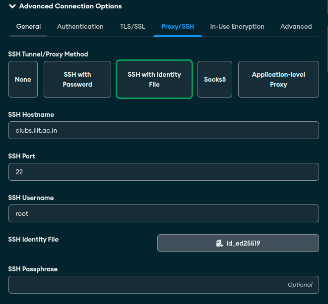
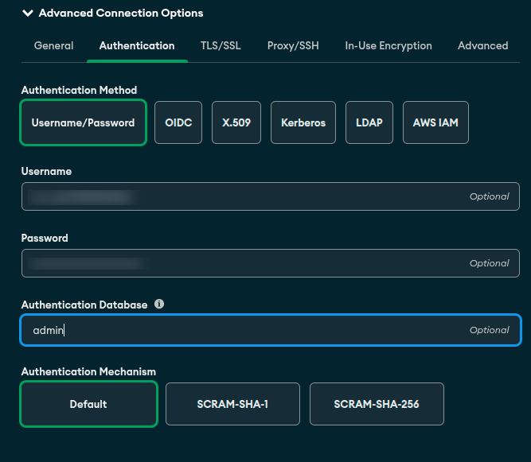

# Services

Configurations for services and containers for the Clubs Council Website.

## Setup

- Clone the main repository and submodules (make sure your SSH-key has access to private repos too):

```bash
git clone -j8 --recurse-submodules --remote-submodules git@github.com:Clubs-Council-IIITH/services.git
cd services
```

## Testing

- To test in local machine run the following script which runs the micro-services in foreground.

```bash
docker compose -p services up --build
```

- To run the service locally in background, run the following script:

```bash
docker compose -p services up --build -d
```

- To stop the service, run the following script:

```bash
docker compose -p services down
```

## Preparing for Deployment

Make sure all the submodules are upto date, once you pull all the latest changes in the individual submodules.
```sh
git submodule update --remote --merge --recursive
```

Then, to make services point to the newest submodule
commits:
```sh
git add .
git commit -m "Update Submodules"
git push
```

## Deployment

Deployment scripts (`deploy.sh`, the deploy check, and remote setup) live in the
[setup repo](https://github.com/Clubs-Council-IIITH/setup), which should be cloned
next to this one. From the setup repo:

```bash
scripts/deploy.sh <command>
```

See the setup repo README for the available commands.

## Connecting to mongo container using mongo compass

Add a new connection, and then in advanced settings:
* General Tab:
    * Host: localhost (or 127.0.0.1)
    * Port: 27017 (or 27018 for staging)
* Authentication Tab:
    * Fill username and password of the mongo container
    * Host: localhost (or 127.0.0.1)
    * Port: 27017 (or 27018 for staging)
* Proxy/SSH Tunnel Tab:
    * SSH Hostname: 10.10.32.47 (or clubs.iiit.ac.in)
    * SSH Username: root
    * SSH Identity File: /home/\<USERNAME\>/.ssh/id_ed25519




